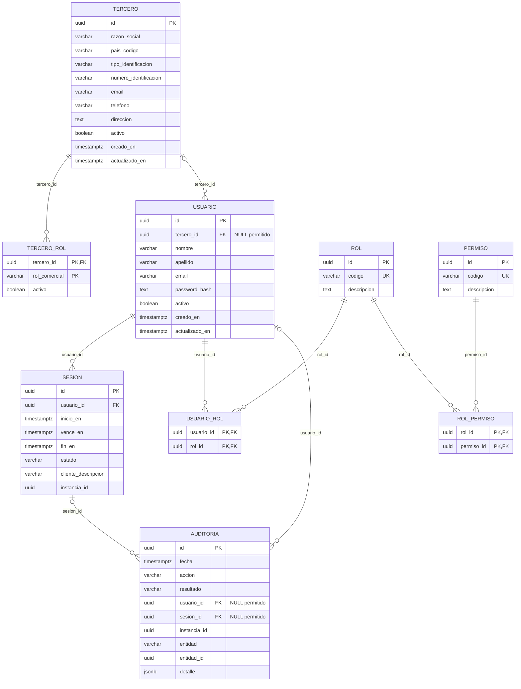
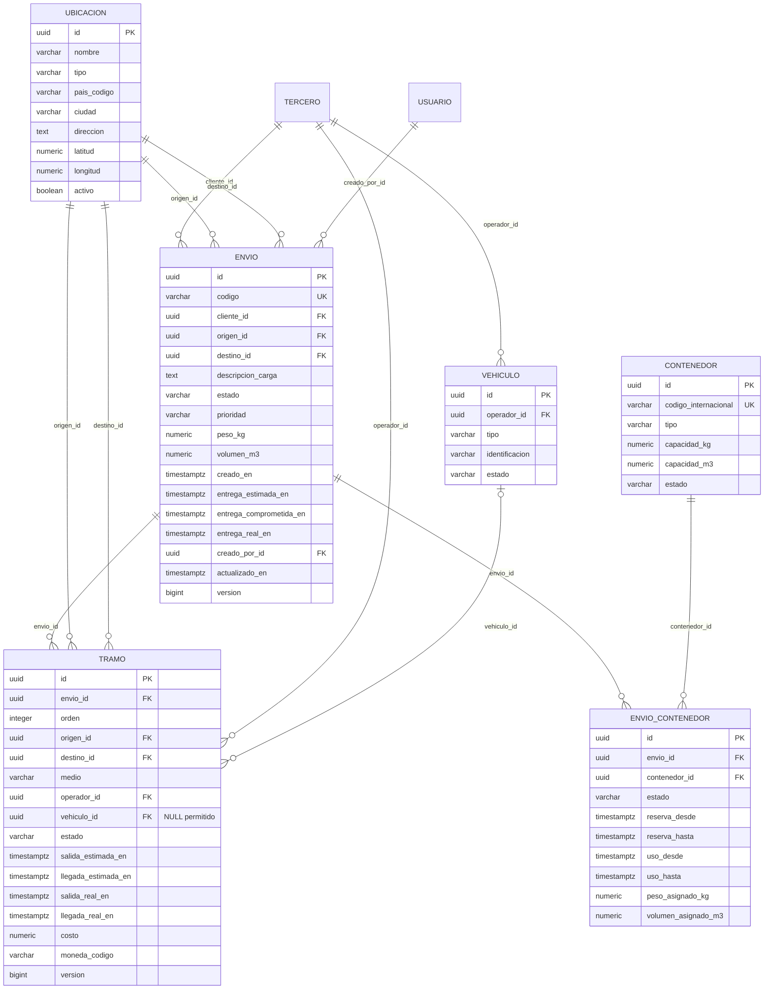
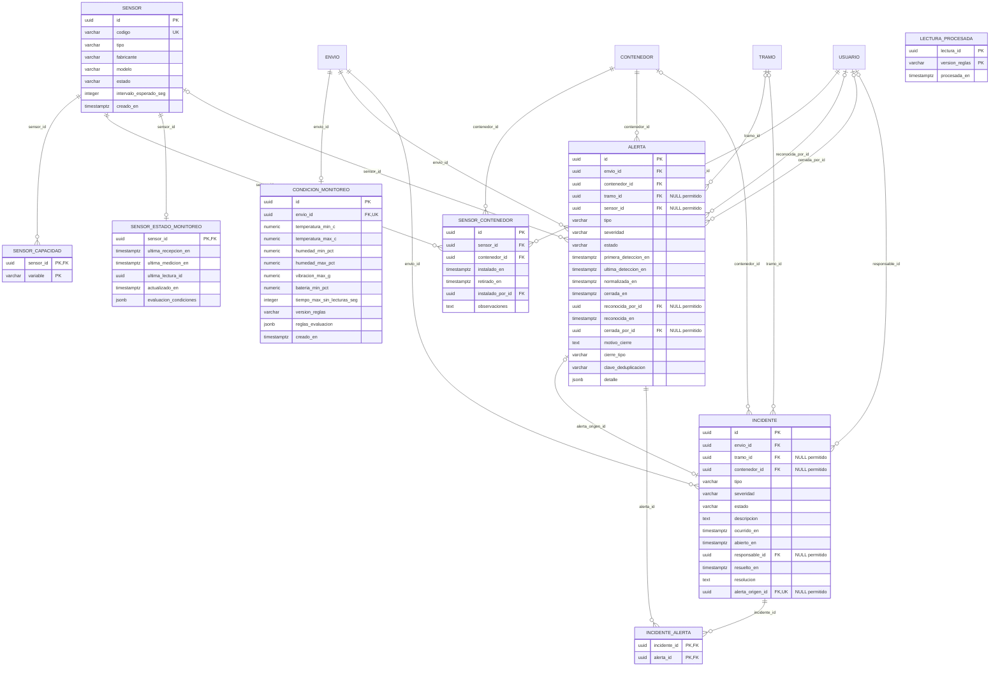
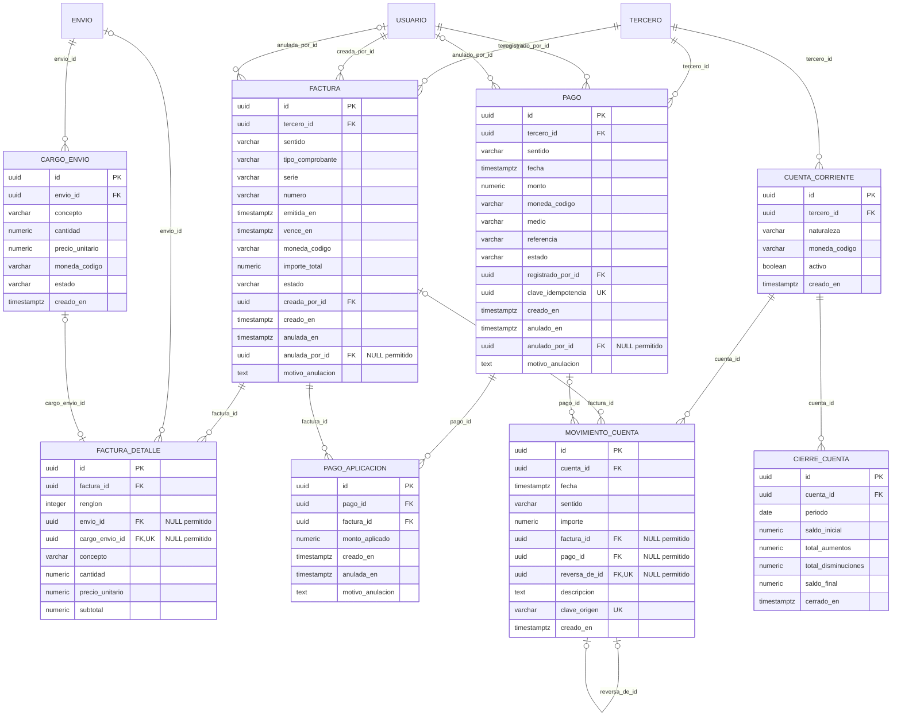
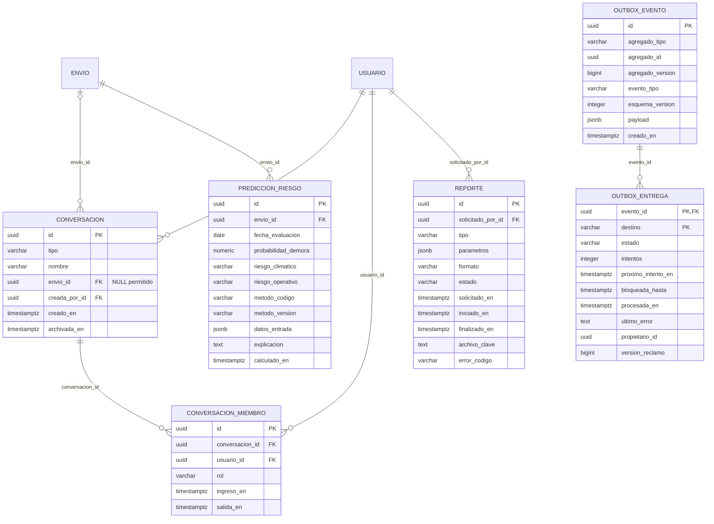
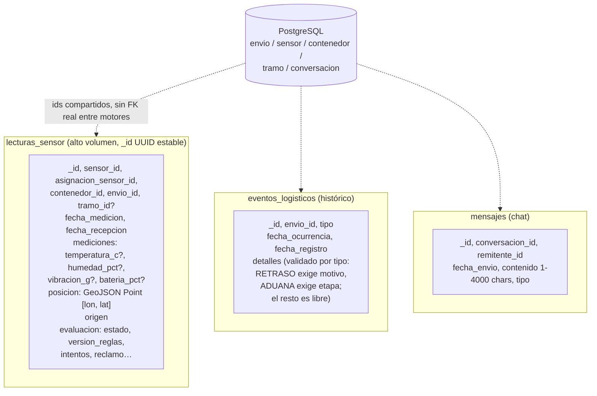
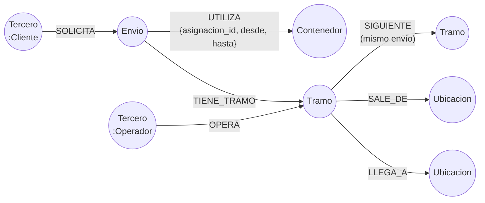

# Diagramas de los modelos físicos

Anexo del [informe final](./informe-final.md). Los modelos se derivan de los scripts incluidos en `db/`, sin ejecutar la aplicación ni conectarse a las bases.

## 1. PostgreSQL — 38 tablas en 5 módulos

Se muestran todas las columnas declaradas en los scripts de creación, sus claves primarias y foráneas. Los tipos se simplifican en los diagramas (por ejemplo, `NUMERIC` sin precisión); los scripts conservan longitudes, precisión, valores por defecto, restricciones, índices y triggers.

Cada vínculo representa una FK concreta. En el extremo de la tabla referenciada, `o|` significa referencia opcional (NULL) y `||` referencia obligatoria; en el otro extremo, `o{` permite varias filas y `o|` indica una FK UNIQUE o PK individual. Una PK compuesta no hace única cada columna por separado. La cardinalidad describe el esquema SQL; las reglas adicionales de servicio se explican en el informe.
### 1.1 Acceso (9 tablas)

Fuente: `db/postgres/010_acceso.sql`.

### 1.2 Logística (6 tablas)

Fuente: `db/postgres/020_logistica.sql`.

### 1.3 Monitoreo (9 tablas)

Fuente: `db/postgres/030_monitoreo.sql`.

### 1.4 Comercial (8 tablas)

Fuente: `db/postgres/040_comercial.sql`.

### 1.5 Comunicación y procesos (6 tablas)

Fuente: `db/postgres/050_comunicacion_procesos.sql`.

## 2. MongoDB — 3 colecciones (`db/mongo/setup_mongo.py`)

Índices clave: `ix_lectura_sensor_fecha`, `ix_lectura_posicion_2dsphere` (GeoJSON), `ix_evento_envio_fecha_id`,
`ix_mensaje_conversacion_fecha_id` (paginación estable por `(fecha, _id)`). `lecturas_sensor` está preparada
para sharding por `(sensor_id, fecha_medicion)` (no activado; ver `docs/informe-final.md` §8).

## 3. Neo4j — modelo de grafo (`db/neo4j/constraints.cypher`)

Es una **proyección reconstruible desde PostgreSQL** (nunca la fuente de verdad de permisos, saldos o
estados): se recalcula por envío con `MERGE` por clave estable y una guarda de versión (un evento viejo
nunca pisa una proyección más nueva). Neo4j Community no admite constraints de existencia ni unicidad sobre
relaciones, por eso `UTILIZA.asignacion_id` y `(envio_id, orden)` de `Tramo` se garantizan en el repositorio,
no por el motor. 7 constraints de unicidad + 5 índices (listados en `db/neo4j/constraints.cypher`).
